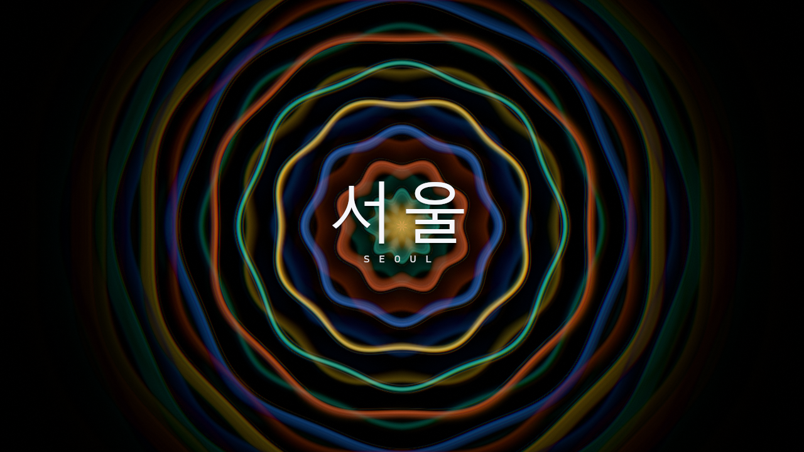

# Seoul · 서울



A real-time music visualizer in the MilkDrop tradition, written in Rust.
Seoul captures whatever your desktop is playing, turns it into bands, beats,
tempo and spectrum, and feeds that to shader visuals. Each frame is drawn
over a warped, fading copy of the frame before it, so the image builds trails
and keeps moving.

**[Download](https://github.com/chrischaps/Seoul/releases/latest)** for
Windows, macOS (untested) or Linux · [Project page](https://chaps.dev/projects/seoul)

## Running it

**Windows 10/11:** unzip the release, play some music, and run `seoul.exe`.
Keep the `presets` folder beside the exe. The exe isn't code-signed, so
Windows SmartScreen may warn the first time: choose **More info → Run anyway**.

**macOS 14.6+ (untested):** the Mac build is produced by CI, but nobody has
run it on a real Mac yet, so reports are very welcome. It's ad-hoc signed,
not notarized, so the first launch needs **System Settings → Privacy &
Security → Open Anyway**. Then allow system audio recording when asked. Seoul
keeps its presets, settings and screenshots in
`~/Library/Application Support/Seoul`. Fullscreen is ⌃⌘F, and Cmd-Q quits.

**Linux (x86_64 or aarch64, glibc 2.36+):** untar the release and run
`./seoul --mic`. Linux has no system-audio loopback, so Seoul listens to an
input. Under PulseAudio or PipeWire, `--input monitor` hears what the
computer is playing. Settings and favorites live in `~/.config/seoul`, so a
new release can replace the folder. The aarch64 build is for the Raspberry
Pi 5. The HUD uses the Noto and DejaVu fonts (`fonts-noto-core
fonts-noto-cjk fonts-dejavu-core` on Debian and Ubuntu).

| Key | |
|---|---|
| Space / Backspace | next / previous preset, in an order reshuffled each lap |
| R · A · L | shuffle · auto-advance · lock |
| F · 1–9 · X | favorite · jump to favorite · hide |
| H · F1 · P | help · stats · screenshot |
| F11 · Esc | fullscreen · quit |

On a touchscreen, tap for the next preset and tap with two fingers to quit.

`seoul.exe --synth` plays a built-in 124 BPM test track. Use it when nothing
else is playing.

`seoul.exe --mic` listens to the room instead: a record, a guitar, people
talking. It learns the room's background noise, subtracts it, and lifts
what's left, so a record across the room moves the picture and an empty
room stays still. `--input <NAME>` picks a microphone or line-in by name
(`--list-inputs` shows them), and `[audio]` in `seoul.toml` makes it stick.
Sound is analysed and dropped; nothing is recorded.

`seoul.exe --frame --mic` makes Seoul a picture on the wall. It goes
fullscreen with no on-screen text and changes presets by itself (your
favorites, once you have some). When the room is quiet the picture rests:
slow and dim, nearly still. Talk lifts it a little; music plays it fully.
In the evening its light turns warm, and from 11 pm to 7 am it sleeps
unless a record is playing. `[frame]` in `seoul.toml` sets the hours.

`--help` lists all the options. Settings live in `seoul.toml` and apply
while Seoul is running.

## Building from source

```bash
cargo run --release               # debug builds are too slow for 60 fps
cargo test
.\packaging\package.ps1           # → dist\seoul-<version>-windows-x64.zip
./packaging/package-macos.sh      # on a Mac → dist/seoul-<version>-macos-universal.zip
./packaging/package-linux.sh      # on Linux → dist/seoul-<version>-linux-<arch>.tar.gz
```

Linux builds need `pkg-config` and `libasound2-dev`.
`packaging/linux.Dockerfile` is a Debian bookworm build box that also
cross-compiles for the Raspberry Pi 5 (`package-linux.sh aarch64`).
`--bench 8` times every preset with vsync off and saves the frame rates
to `screenshots/bench/`.

System audio comes in through cpal's loopback capture. That's WASAPI on
Windows and a CoreAudio process tap on macOS 14.6+. Microphones and line
inputs use the same cpal host (ALSA on Linux). The HUD uses fonts the OS
already ships. Every push to `main` builds and tests all three platforms in
GitHub Actions, and pushing a `v*` tag drafts a release with every package.

## Presets

A preset is a TOML file plus one or two WGSL functions. The TOML holds motion
expressions driven by the audio (`zoom = "1.0 + bass * 0.012"`), a palette
and a look. The WGSL draws each frame and can also warp the previous one.
Saving either file while Seoul is running reloads it right away. A broken
shader shows its error on screen with the file and line, and the music keeps
playing. See **[docs/PRESETS.md](docs/PRESETS.md)** for the authoring guide.

## How it works

Seoul runs three threads. The audio callback fills a ring buffer. An analysis
thread runs an FFT every 256 samples and writes the results to a triple
buffer. The render thread runs the pass chain:

**warp → particles → composite → bloom → post → HUD**

It renders over a pair of `Rgba16Float` feedback textures. Transitions between
presets are per-pixel masks stored in the feedback alpha channel, so a
dissolve, a radial wipe or a clock sweep never touches preset code.
**[docs/ARCHITECTURE.md](docs/ARCHITECTURE.md)** has the full story.
